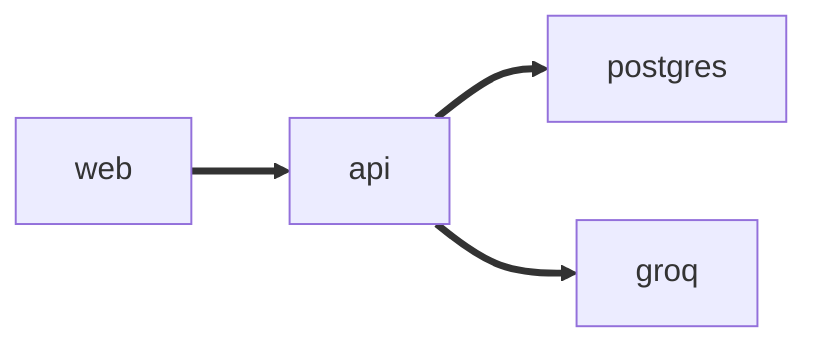

<picture>
  <source media="(prefers-color-scheme: dark)" srcset="docs/logo_dark.svg">
  
</picture>

Runs on Django API, React storefront, Groq on top.

[](https://github.com/tech-dipesh/Infilect_oa/actions)
[](https://infilect-web.vercel.app)
[](https://infilect-api.vercel.app/api/docs/)

Live app: https://YOUR-WEB-URL | API docs (Swagger): https://infilect-api.vercel.app/api/docs/| Demo login: `dipu@infilect.com` / `dipu@123`

## What it does
- Register and log in with JWT. Anyone can browse, only the creator can edit or delete a product.
- Product list with search, category filter, sorting and 12 per page. Details page, add, edit and delete.
- Loading, empty and error states on every screen, responsive from phone to desktop.
- Two Groq features: generate a product description, and search in plain language ("cheap shoes under 4000").

## Stack

| Layer | Tech |
| --- | --- |
| api | Python 3.12+, Django 6, Django REST Framework, simplejwt, drf-spectacular, uv |
| web | React 19, Vite, TypeScript, Tailwind CSS v4, react-router, Axios, pnpm |
| data | SQLite locally, PostgreSQL (Neon) in production |
| llm | Groq, `llama-3.3-70b-versatile` by default |
| ops | Docker Compose, GitHub Actions, Vercel |



## Quick start

```bash
cd api && cp .env.example .env && uv run seed
```

```bash
uv run dev
```

```bash
cd web && cp .env.example .env && pnpm i
```

```bash
pnpm dev
```

The api is on the  http://localhost:8000 and the app on http://localhost:5173. `seed` adds the demo user and 12 sample products, and can be run again safely. Groq api need to run it.

Or run the api and Postgres in Docker: `GROQ_KEY=Add-Here docker compose up --build`

Scripts in `api`: `uv run dev`, `migrate`, `generate` (makemigrations), `seed`, `lint`, `test`. In `web`: `pnpm dev`, `build`, `lint`, `type`.
## Decision:
- **Two apps, one repo.** `api/` and `web/` deploy separately, so the frontend talks to the api only through REST and CORS.
- **JWT in a Bearer header.** Simple across two domains. Access tokens last 30 minutes and the web client refreshes them once on a 401. The tradeoff is that tokens live in localStorage.
- **SQLite locally, Postgres in production.** One `DB_URL` switches them.
- **Category is a plain string.** Fewer tables for an MVP. The category dropdown is built from the values that exist.
- **Owner only writes.** Every product stores its owner and a permission class blocks edits from anyone else.
- **One error shape.** Every failure is `{ "error": ... }`, and validation messages read "Please enter a ...".
- **Public AI search with a rate limit.** Search is open so visitors can try it, and both AI endpoints are limited to 20 requests a minute. On Vercel the counter is per instance, so treat it as a soft limit.

## GenAI
Both features use Groq through one small client (`api/ai/llm.py`) with an 8 second timeout.

**Generate description.** On the add and edit form, once name, brand and category are filled in, the button calls `POST /api/ai/description/` (login required).

**Natural language search.** The "Ask AI" button next to search calls `POST /api/ai/search/`. The model turns a sentence into filters (`search`, `category`, `min_price`, `max_price`, `ordering`) as JSON. It is given the real category list so it can only pick one that exists.

# Thanks.