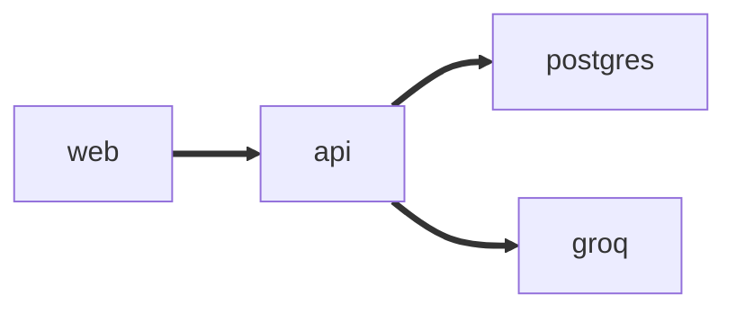

<picture>
  <source media="(prefers-color-scheme: dark)" srcset="docs/logo_dark.svg">
  
</picture>

Runs on Django API, React storefront, Groq on top.

[](https://github.com/tech-dipesh/Infilect_oa/actions)
## Does:
- Register and log in with JWT. Anyone can browse, only the creator can edit or delete a product.
- Product list with search, category filter, sorting and 12 per page. Details page, add, edit and delete.
- Loading, empty and error states on every screen, responsive from phone to desktop.
- Two Groq features: generate a product description, and search in plain language ("cheap shoes under 4000").

## Stack

| Layer | Tech |
| --- | --- |
| api | Python 3.12+, Django 6, Django REST Framework, simplejwt, drf-spectacular, uv |
| web | React 19, Vite, TypeScript, Tailwind CSS v4, react-router, Axios, pnpm |
| data | SQLite locally, PostgreSQL (Neon) in production |
| llm | Groq, `llama-3.3-70b-versatile` by default |
| ops | Docker Compose, GitHub Actions, Vercel |



## Quick start

```bash
cd api && cp .env.example .env && uv run seed
```

```bash
uv run dev
```

```bash
cd web && cp .env.example .env && pnpm i
```

```bash
pnpm dev
```
